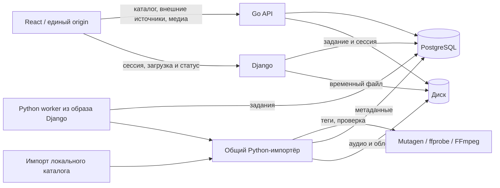

# Архитектура WaveBox

## Аудит репозитория

| Область | Реализация и границы |
| --- | --- |
| React/Vite | Веб-плеер, поиск и загрузка. Vite проксирует пути Go и Django под одним origin. Плейлисты, избранное и часть пользовательского состояния хранятся в localStorage, поэтому между устройствами не синхронизируются. В исходном дереве также присутствуют демонстрационные дорожки и fallback в musicApi. |
| Go | GET /health, GET /api/tracks, GET /api/external/search, GET /api/external/internet-archive/files и файловые маршруты /audio/ и /covers/. PostgreSQL читается через pgx. Go сопоставляет поисковые варианты по нормализованным названию, исполнителю и длительности. Это группировка выдачи, а не удаление файлов. |
| Источники | Muzsky возвращает ссылки на ручное получение, Internet Archive ищет карточки и разрешённые файлы, Jamendo использует официальный API при заданном client ID. Bandcamp, Qobuz и FMA представлены внешними ссылками. Проверки JSON/HTML на fixtures подтверждают поведение парсеров. Живая доступность каждого провайдера зависит от его API. |
| Django | Маршруты /api/auth/csrf, register, login, logout, me и upload используют Django sessions и CSRF. Рабочее дерево уже содержало транспорт загрузки разрешённых файлов Internet Archive с проверками адресов, редиректов и размера. Django передаёт файл общему импортёру и хранит очередь, привязанную к учётной записи. |
| PostgreSQL | Django управляет пользователями, сессиями и заданием MusicImport. SQLAlchemy/Alembic управляют artists и tracks. 0001 создала каталог, 0002 добавила свойства аудио, 0003 добавила SHA-256, codec, channels и duration_ms. Аудио и обложки хранятся на диске. |
| Compose и CI | PostgreSQL, Go, Django, frontend, one-shot миграции, импортёр каталога, один фоновый worker. GitHub Actions проверяет Go, Python и миграции на PR и push в main. Автоматического развёртывания в репозитории нет. |
| Технический долг | Go выдаёт общий каталог и медиа без учёта пользователя. Django runserver и Vite используются как локальные серверы разработки. Серверный reverse proxy/TLS, квоты и наблюдаемость требуют отдельного этапа перед публичным развёртыванием. |

## Поток запросов и владение

Worker занимает один процесс без брокера и собственного HTTP API. Он использует ту же сборку, сеть и том, что и Django. PostgreSQL выдаёт задания через блокировку строки с SKIP LOCKED. После остановки процесса незавершённая транзакция освобождает задание. Ответы 5xx повторяются до трёх попыток с задержкой 5 и 10 секунд. Финальный статус доступен только владельцу задания. Для клиентов без `Prefer: respond-async` сохранён синхронный контракт. Веб-клиент отправляет этот заголовок и опрашивает `GET /api/auth/imports/{id}`.

## Импорт файла

1. Django пишет загрузку с проверкой размера во временный файл. Для Internet Archive сервер читает разрешённый элемент и сам строит URL. Локальный CLI читает файлы из подготовленного каталога, пропуская символические ссылки. Поступившее имя используется только для выбора разрешённого формата.
2. Python запускает ffprobe с таймаутом 10 секунд и FFmpeg с таймаутом 45 секунд. Используется один поток декодирования, ограничение отдельной аллокации и локальный протокол. Результат декодирования отбрасывается, исходный файл сохраняется.
3. Mutagen читает теги и встроенное изображение. Probe дополняет теги контейнера. Название и исполнитель нормализуются в Unicode NFC и ограничиваются длиной полей. Для Internet Archive можно дополнить отсутствующие теги метаданными из разрешённой карточки. При отсутствии обязательных полей загрузка получает 422, CLI сообщает о пропуске. Обложка ограничена по размеру и сигнатуре типа изображения.
4. SHA-256 сравнивается с индексируемой колонкой PostgreSQL. Загруженные файлы публикуются локальной жёсткой ссылкой по имени, производному от хеша. Импорт каталога сохраняет существующий URL. В критической секции PostgreSQL общая advisory-блокировка сериализует финальную проверку, публикацию и запись каталога. При ошибке до commit новые файлы удаляются. При неопределённом результате commit они остаются для безопасной повторной попытки. Отключение питания может оставить файл без строки каталога, поскольку PostgreSQL и файловая система не имеют общей транзакции.
5. Go читает новую строку и отдаёт её в существующей схеме GET /api/tracks. Для старых строк миграция сохраняет прежние пути и добавляет nullable-поля. Повторный запуск импортёра заполняет поля проверяемых старых файлов. При двух старых строках с одинаковыми байтами их идентификаторы сохраняются, а SHA-256 закрепляется за первой найденной копией.

## Обогащение и идентичность

P1 добавляет таблицы `track_enrichment` и `metadata_cache` через Alembic 0004. Команда `enrich_tracks.py` работает пакетно в образе существующего импортёра после публикации трека. Она отправляет MusicBrainz название и исполнителя, сравнивает нормализованные теги и измеренную длительность локально и сохраняет кандидатов. Уникальное совпадение в пределах двух секунд принимается, если выдача не усечена и у записи нет уточнения версии. При неоднозначной выдаче Recording MBID остаётся пустым. Совпавший Recording MBID индексируется и может принадлежать нескольким дорожкам. Оригинальные строки, пути и теги сохраняются. SHA-256 остаётся ключом автоматического устранения точных повторов.

Cover Art Archive запрашивается по единственному подходящему Release MBID, если отсутствует локальная обложка и включён `MUSICBRAINZ_FETCH_COVERS=1`. Изображение проверяется по сигнатуре и публикуется через атомарное переименование. HTTPS-запросы ограничены по времени и размеру. Переходы CAA разрешены на Archive.org и его CDN с проверкой публичного IP и сертификата на каждом запросе.

Один процесс обогащения на базу обеспечивается advisory-блокировкой PostgreSQL. Кэш хранит ответ и срок действия. MusicBrainz получает не более одного запроса в секунду на базу. Повторные команды используют ответы MusicBrainz до семи дней, миниатюры до 30 дней и ответы 404 до суток. При 429/5xx действует пауза с учётом Retry-After, а следующая обработка трека откладывается. Импорт и выдача каталога продолжают работать независимо. Для повторных попыток команда должна запускаться периодически.

Музыкальный файл без достаточных тегов по-прежнему требует локальных тегов либо предоставленных источником метаданных. Акустическая идентификация и интерфейс ручного разбора кандидатов относятся к следующим этапам.

## Плейлисты

Django хранит импортированные плейлисты как пользовательские снимки PostgreSQL. Это состояние учётной записи, в то время как Go обслуживает общий музыкальный каталог и внешний поиск. Существующие браузерные плейлисты и избранное продолжают храниться локально. Маршруты под `/api/auth/playlists/imported` используют сессии и CSRF.

Внешние адаптеры приводят UTF-8 CSV, JSPF и официальный ListenBrainz API к одному порядковому списку. Максимум 500 позиций и 1 МиБ входных данных. URL из экспорта используются только для распознавания Recording MBID. Запросы ListenBrainz идут на фиксированный HTTPS-хост без редиректов. Пользовательский токен для приватного плейлиста передаётся только на время операции. [ListenBrainz Playlist API](https://listenbrainz.readthedocs.io/en/latest/users/api/playlist.html)

Позиция сопоставляется с доверенным Recording MBID в каталоге. Когда точного MBID нет, допускаются кандидаты по нормализованным названию, исполнителю и длительности с допуском две секунды. Один кандидат без проверяемой длительности или без подтверждённого MBID при внешнем MBID требует ручного выбора. Несколько файлов с одним MBID также требуют ручного выбора. Снимок хранит порядок, повторы, статусы и локальные ID. Ручной выбор переносится на ту же идентичность и номер повтора при синхронизации, если файл ещё есть в каталоге.

Повторная синхронизация ListenBrainz читает полный снимок, а локальный снимок можно обновить заменой файла. Сравнение ревизии предотвращает перезапись изменений из параллельного запроса. Ошибка внешнего источника сохраняет предыдущую ревизию. Отдельная операция повторно сопоставляет прежний снимок с текущей медиатекой.

Поиск недостающего аудио использует Go-адаптеры Internet Archive и Jamendo. В интерфейсе пользователь выбирает конкретный файл Internet Archive, а Django повторно проверяет доступность и отправляет его в существующую очередь. Jamendo возвращает ссылку только при разрешении скачать дорожку, после чего файл можно загрузить обычным способом. Плейлист не запускает приобретение аудио самостоятельно.
